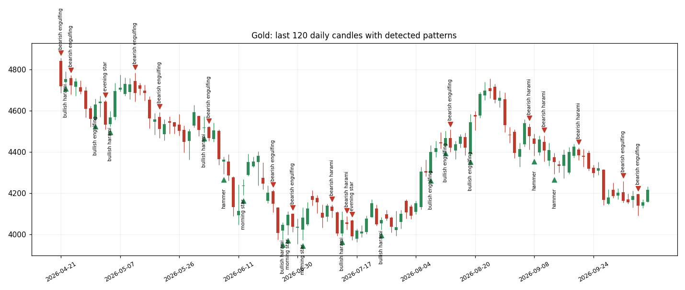

# Candlestick Pattern Engine

Detects 12 classic candlestick patterns on daily futures prices (crude oil, gold, E-mini S&P 500,
10-year T-note), labels every candle, and tests whether each pattern actually predicts the next
1, 5 and 10 days compared with the base rate. Runs weekly with GitHub Actions.

**Report:** [reports/pattern_report.md](reports/pattern_report.md)



## Key results
- 16,838 daily candles (crude oil, gold, E-mini S&P 500, 10-year T-note, 2010-2026) labelled; 4,436 directional pattern signals.
- Only 2 of 108 pattern/instrument/horizon tests passed |t| >= 2, fewer than the ~5 expected by chance: no reliable stand-alone edge.
- Bullish patterns were followed by up-moves ~52% of the time vs a 54-55% base rate; the largest edges came from patterns with fewer than 25 signals.
- Data checks dropped 34 impossible candles; unusually frequent gold marubozus point to source data issues.

## Patterns and rules
Candle anatomy: body = |close - open|, range = high - low, upper/lower shadows. Thresholds live in `src/config.py`.

| Pattern | Candles | Rule (summary) |
| --- | --- | --- |
| Doji | 1 | body at most 10% of the range |
| Hammer | 1 | lower shadow at least 2x body, upper shadow at most 25% of range, after a 5-day decline |
| Bullish / bearish marubozu | 1 | both shadows at most 5% of the range |
| Bullish / bearish engulfing | 2 | second body opposite in colour and fully covers the first body |
| Bullish / bearish harami | 2 | long first body; second, opposite-colour body sits inside it |
| Morning / evening star | 3 | long first body, small middle body, third closes beyond the first body's midpoint |
| Three white soldiers / black crows | 3 | three same-colour bodies, each closing further and opening inside the previous body, small shadows at the close end |

Every candle also gets a type (bullish, bearish, doji), and each pattern is stamped on the candle where it completes.

## Research method
- Forward return = close of the signal candle to the close 1, 5 or 10 trading days later.
- Hit rate = share of signals followed by a move in the predicted direction; base rate = the same share on all days;
  edge = the difference. A t-stat compares the average forward return after signals with all days.
- A result is flagged only with at least 30 signals, |t| >= 2 and the move in the predicted direction.
- Caveats: continuous front-month futures include roll jumps; overlapping windows inflate t-stats; testing many
  patterns makes some false positives likely; no transaction costs.

## Run it yourself
```bash
python3.11 -m venv .venv
source .venv/bin/activate
pip install -r requirements.txt
pytest -q          # every pattern rule tested on hand-made candles
python3 run.py     # download prices, detect patterns, measure forward returns, write report
```
Prices come from Stooq's free daily CSVs (Yahoo Finance via `yfinance` as a fallback if installed).
You can also save your own CSV as `data/raw/<instrument>.csv` with columns Date, Open, High, Low, Close.

## Project structure
```
src/config.py     instruments, thresholds, horizons
src/data.py       download and clean daily OHLC
src/patterns.py   candle anatomy and the 12 pattern rules
src/research.py   forward returns, hit rates, edge and t-stats
src/chart.py      candlestick chart with patterns marked
run.py            runs everything and writes outputs/ and reports/
tests/            unit tests for every pattern
```
